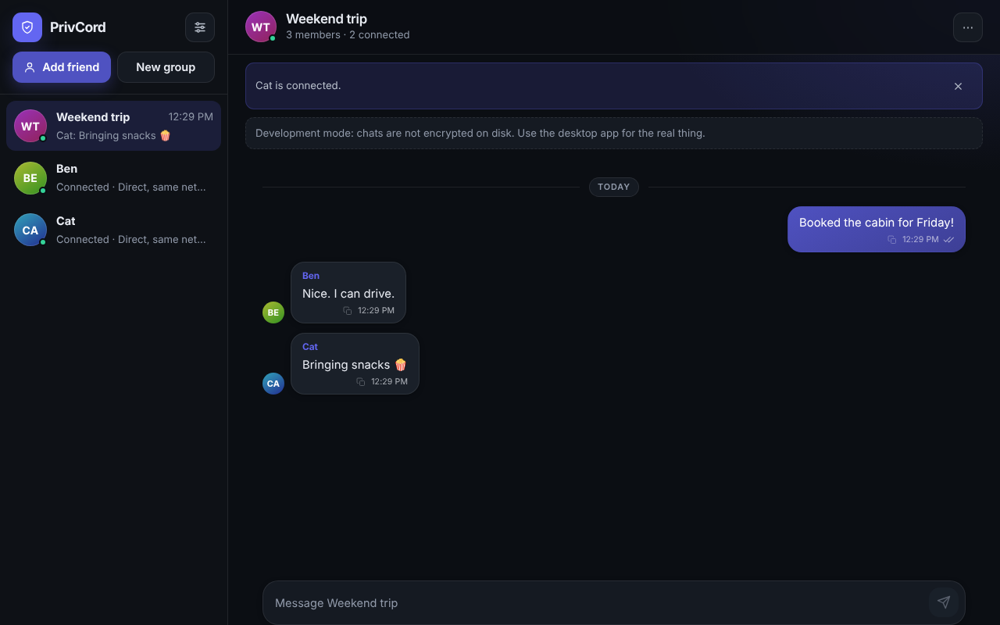
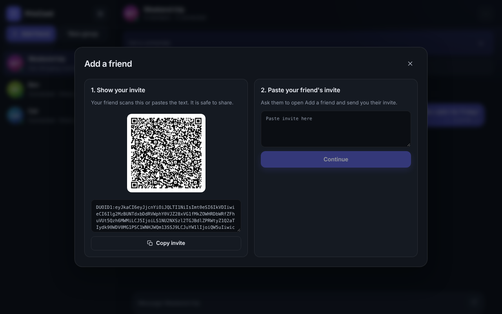
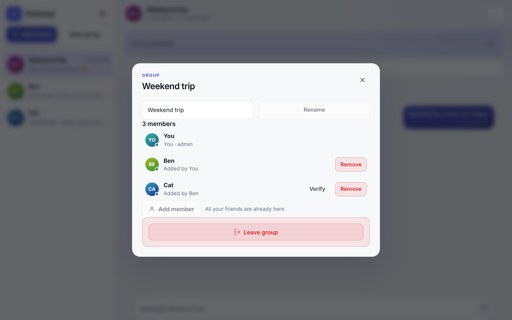

# PrivCord

**Private messaging with no accounts and no server that can read your chats.** Add friends with a QR code,
chat one-to-one or in groups, and PrivCord connects your devices directly, over the internet or over
Bluetooth.

<p align="center">
  
</p>

## What you can do

- **Add a friend in seconds.** Show a QR code or six words; your friend scans the code or types the words, and you tap *Add* when they answer. No long strings to copy.
- **Chat one-to-one** with end-to-end encryption. Messages go straight from device to device.
- **Reply** to any message. The quote shows for everyone, in chats and groups.
- **Send files up to 8 MB.** Photos and videos show a preview you can open; every file can be saved.
  They go straight to the other device, free, with no upload to anyone's server.
- **Join public channels** like #general (no account, anyone who types the same name is in the same room). Messages are signed, so nobody can speak as someone else, but anyone who knows the name can read them.
- **Reach people with no internet (Android).** An optional Bluetooth mesh passes messages along through nearby phones, up to 7 hops. Experimental: simulated, never run on real radios.
- **Make it yours.** 16 built-in color themes (Midnight, AMOLED black, Nord, Dracula, Solarized, Blossom pink, Rose, Paper, Sky, Mint and more) plus the classic light/dark look, on both Windows and Android. Settings > Appearance.
- **Lock the app.** Android asks for your fingerprint, face or screen lock; Windows asks for Windows Hello
  (a passkey). Turn it on or off in Settings > Security.
- **Make groups of up to 10.** Create a group, add friends, and anyone in the group can add more people.
  If you add Ben and Ben adds Cat, you and Cat connect automatically. No codes to swap.
- **Stay private in groups.** Turn on *Stay group-only* (Settings > Security) and people you only meet
  through a group can talk to you in the group but cannot message you directly. If either of you has it
  on, you can still pair by swapping invites.
- **Keep working when things go wrong.** Messages you send while someone is offline wait and are sent
  when you reconnect. Connections recover on their own.
- **Use Bluetooth with no internet** (needs a phone on one side; see the status table below).
- **Own your identity.** A 12-word recovery phrase is your account. Write it down: the same words
  restore your identity on a new device.
- **Wipe everything** from Settings > Security if you ever need to.

<p align="center">
  
  
</p>

## How it connects (and what it needs)

PrivCord has **no account system and no server that reads messages**. It is **not serverless**: to find a
friend across the internet it uses a few optional services. They do different jobs, and you can run your own.

| Service | Job | Sees your messages? | Needed? |
|---|---|---|---|
| **Signaling** (public Nostr relays, or your own) | Helps two devices find each other | No (sealed, signed blobs) | For automatic reconnect |
| **STUN** | Tells a device its public address | No | Without it, only same-network links |
| **TURN** | Relays the encrypted stream when a direct link is impossible | No (sees only encrypted data) | Only on strict networks |
| **Store-and-forward relay** | Holds sealed messages for friends who are offline | No | Off by default |
| **Bluetooth LE** | Local link, no internet at all | No | Optional |

The defaults use public third-party STUN and Nostr servers. They can see connection metadata (your IP
address and when you connect), never message content. Change them under *Settings > Advanced*, or host
your own: [docs/DEPLOYMENT.md](docs/DEPLOYMENT.md). The app shows the real connection type
(*direct*, *relayed*, *Bluetooth*), measured from the live connection.

## Get it

The Windows desktop app and the Android apps are built by CI. Open the latest **CI** run on GitHub and
download the artifacts:

| Artifact | What it is |
|---|---|
| `duochat-windows-unsigned` | Windows installer (unsigned, so SmartScreen warns you) |
| `duochat-android-debug` | Android app (`com.duochat.app`), running on the shared Rust engine |

Android debug builds are signed with one fixed debug key (`apps/android/keystore/debug.keystore`, committed on
purpose, protects nothing), so a newer build updates an older one in place. Building from source:
[docs/DEPLOYMENT.md](docs/DEPLOYMENT.md), [docs/rust/ANDROID.md](docs/rust/ANDROID.md).

## Architecture

PrivCord is one set of rules (identity, contacts, delivery, groups, files, channels, mesh) with thin platform
shells around it. The rules exist in three places today:

| Implementation | Where | Used by |
|---|---|---|
| **Rust engine** (the target) | `crates/` | Android "rust" build and the Windows app (its only engine) |
| TypeScript protocol | `packages/protocol`, `apps/desktop/src/lib` | Desktop app |
| Kotlin protocol | `apps/android/.../{data,security,engine,groups,p2p}` | Nothing at runtime: the Android app runs the Rust engine; kept for its tests and as the reference it was ported from |

The three are kept in step by shared test vectors (`docs/*-vectors.json`): the Rust crates both produce vectors
the TypeScript tests open, and open vectors the TypeScript code produced. CI checks both directions.

### Layers (what each one does)

| Layer | What it does |
|---|---|
| **Identity** | A 12-word BIP-39 phrase derives two P-256 keys: one signs (ECDSA), one agrees on secrets (ECDH). The user id is the SHA-256 fingerprint of the ECDH public key. Same phrase, same identity, on any device. |
| **Contacts** | A friend is a pinned identity card (public keys plus a signature binding them), exchanged by QR, six words or pasted text. `verified` = cards exchanged directly; `introduced` = learned from a group. Safety numbers let two people compare keys out loud. |
| **Links** | One authenticated, encrypted channel per contact: a WebRTC data channel, or Bluetooth LE with its own forward-secret secure channel. After connecting, both sides prove they hold the pinned keys. A ping and a liveness timer drop dead links. |
| **Finding each other** | Sealed (encrypted and signed) connection setup delivered through signaling: Nostr relays or your own relay, or through a mutual friend. Optional store-and-forward for offline friends. |
| **Groups** | A signed event log every member holds and folds the same way. Members can add members (up to 10); an added member's card is the introduction, so everyone connects automatically. Messages go to each member over that member's own link. |
| **Files, channels, mesh** | 8 MB files in 12 KiB chunks over direct links. Public channels keyed by name. A Bluetooth mesh that floods sealed blobs for up to 7 hops (Android). |
| **Storage** | Local SQLite (schema v3) with message text encrypted at rest on desktop. An outbox keeps unsent messages per recipient and resends when the link opens. |

### Data flow for one message

1. You send. The message is stored and queued once per recipient (one for a friend, one per member for a group).
2. Each recipient with an open link gets it straight over that link and acknowledges it (`SENT` then `DELIVERED`, `READ`).
3. Everyone else stays queued. When a link opens the queue is flushed. With store-and-forward on, a sealed copy can also wait on a relay.

### The Rust engine

```
                    UI (Compose / React)
                           │ typed commands, events, snapshots
                    privcord-ffi  (UniFFI: Kotlin bindings, plain data, stable error codes)
                           │
   privcord-engine ── Core: synchronous, deterministic state machine
   (+ Tokio shell: one thread, bounded command queue → `Busy`, timers, clean shutdown)
        │      │       │
 privcord-domain  privcord-crypto  privcord-ports (traits: Storage, SecureStore, Transport, Clock, Notifier)
 pure rules        keys, seals,        │
                   channels, backup    ├─ privcord-storage (SQLite)
                                       └─ platform adapters: WebRTC, Bluetooth, relay/Nostr sockets, Keystore
```

* The engine never touches an OS API, socket or database directly. Platform code implements the port traits and feeds
  link changes and received frames in (`link_up`, `link_down`, `frame_received`).
* Events are numbered and delivered through bounded queues; a reader that falls behind gets `Lagged` and asks for a
  snapshot, which holds everything a recreated UI needs.
* Signaling clients (relay, Nostr, hub) are sans-IO state machines: the adapter opens sockets and feeds messages in.
* Lints: `unsafe` is forbidden except in the FFI crate, and `unwrap`/`expect`/`panic` are denied in library code.
* Details: [docs/rust/README.md](docs/rust/README.md), [docs/rust/COMPATIBILITY.md](docs/rust/COMPATIBILITY.md).

## Algorithms and constants

Everything below is implemented in `crates/privcord-crypto` (and mirrored in TypeScript and Kotlin).

| Purpose | Construction |
|---|---|
| Recovery phrase | 128-bit CSPRNG entropy → 12 BIP-39 words (132 bits with checksum); optional BIP-39 passphrase |
| Identity keys | BIP-39 seed (PBKDF2-HMAC-SHA-512, 2048 rounds) → HKDF-SHA-256 with a fixed salt and per-purpose info (`identity-sign`, `identity-agreement`) → scalar reduced mod the P-256 order. Signing and agreement keys are never reused for each other |
| User id | SHA-256 fingerprint of the ECDH public key (64 hex characters) |
| Contact card | Public keys plus an identity proof: the signing key signs the agreement key, so nobody can claim an id without holding its keys |
| Signatures | ECDSA P-256 |
| Sealed blob (setup, store-and-forward) | Ephemeral ECDH P-256 to the recipient's agreement key → HKDF-SHA-256 (info `to|from`) → AES-256-GCM (AAD `to|from`, random 96-bit IV) → ECDSA signature over the blob. Opened only if addressed to us, from the pinned sender, and unchanged |
| Mailbox | Hash of the recipient id; relays see sealed blobs addressed to a mailbox, never content |
| Safety number | SHA-256 of both signing-key thumbprints, ordered, shown as six groups of five digits. Detects a swapped key; it is not a substitute for an audited protocol |
| Link authentication (WebRTC) | Challenge-response hello: each side sends keys, an identity proof and a nonce, signs the other's challenge, and checks the keys against the pinned card. 15 s timeout |
| Bluetooth secure channel | Signed ephemeral ECDH hello → HKDF-SHA-256 (salt from both nonces, one label per direction) → AES-256-GCM, 96-bit IV from a counter, AAD `sc|n`. Replays and reordering are rejected. Forward secret |
| Bluetooth tags | `HMAC-SHA-256(contact secret, "…ble-tag-v1|epoch")` cut to 8 bytes, 15-minute epochs; a scanner accepts the previous, current and next epoch. Chunk framing: 3-byte header (flags, sequence), reassembly with ordering checks |
| Six-word invite | Six random BIP-39 words (66 bits) → PBKDF2-SHA-256 (150,000 rounds) → HKDF → rendezvous mailbox and AES-GCM key. Lives 15 minutes; the person who types the words is confirmed by safety numbers |
| Public channel | Normalized name → HKDF key and a hashed mailbox; messages are signed by the sender. Not private: anyone who knows the name can read it |
| Backup | Passphrase (NFKC, at least 8 characters) → PBKDF2-SHA-256 (300,000 rounds) → AES-256-GCM. A wrong passphrase and a damaged file look the same |
| Nostr signaling | BIP-340 Schnorr events on secp256k1 signed with a throwaway key per event; kinds 21733 (live) and 31733 (stored), `t` tag = mailbox, `expiration` tag; only valid, unexpired, unseen events become blobs |
| Group log | Signed events (create, add, remove, rename) that name the events they follow; every device folds them in one deterministic order, so every device reaches the same roster with no server. Events from non-members or breaking a rule (admins only remove others, 10 members) have no effect |
| Mesh | Flooding with a 7-hop limit; seen-set against loops; carry for 30 minutes; at most 30 new messages per minute per sender; 8 KB packets; at most 5 stranger links. Relays carry only sealed or signed blobs and need no keys |
| Files | 8 MB maximum, 12 KiB chunks, SHA-256 checked, at most 2 incoming per peer, direct links only |
| X3DH + Double Ratchet | HKDF-SHA-256 chains, AES-256-GCM with derived IV, bounded skipped keys (1000), envelopes and epoch-keyed group messages. **Ported and tested in both directions, but no app calls them yet** ([ADR-009](docs/rust/adr/ADR-009-x3dh-ratchet.md)) |

Other rules: text up to 4,000 characters; groups up to 10; reactions from a fixed set of six emoji; delete for everyone
leaves a tombstone that survives late copies; signaling reconnect backs off from 1 s, doubling to 30 s; relay puts time
out after 8 s; a link silent for 14 s is dropped and redialed.

## For developers

Requires Node.js 20+ for the TypeScript parts and a recent stable Rust (1.82+) for the engine.

```bash
npm install
npm run typecheck
npm test                       # protocol + desktop unit tests
npm run dev:desktop            # UI in the browser at http://127.0.0.1:1420
npm run e2e --workspace @duochat/desktop   # real browsers, relay, Nostr, TURN (needs Playwright)

cargo fmt --all --check
cargo clippy --workspace --all-targets --all-features --locked -- -D warnings
cargo test --workspace --all-features --locked   # real-relay tests need Node (npm ci) and `pip install nostr-relay`
```

Android (`apps/android`): `./gradlew :app:testDebugUnitTest :app:assembleDebug`.
The Rust build needs the native library first: `cargo ndk -t arm64-v8a -t armeabi-v7a -t x86_64 -t x86 -o app/src/main/jniLibs build -p privcord-ffi --release`
(Android NDK and `cargo-ndk`). CI does this for you.

The browser build uses a development store that is **not encrypted at rest** and has no Bluetooth; use the Tauri build
(`npm run tauri:dev`, needs Rust) for the real thing. Run your own relay: `cd relay && npm install && node index.js`
([relay/README.md](relay/README.md)).

| Path | What |
|---|---|
| `crates/privcord-domain` | Pure rules and wire shapes: messages, delivery, connection state machine, files, mesh, channels, diagnosis, BLE framing |
| `crates/privcord-crypto` | Identity, signatures, ECDH, sealed blobs, cards, safety numbers, invites, channels, backups, secure channel, BLE tags, Nostr events, X3DH and ratchet |
| `crates/privcord-ports` | Traits the engine needs from the platform, plus in-memory fakes for tests |
| `crates/privcord-engine` | The application engine, the signaling clients and the live-interop peer example |
| `crates/privcord-storage` | SQLite storage: versioned schema, atomic batches, migrations |
| `crates/privcord-import` | Reads the old desktop and Android databases and backups |
| `crates/privcord-ffi` | UniFFI facade and the generated Kotlin bindings |
| `packages/protocol` | Shared TypeScript protocol, unit-tested |
| `apps/desktop` | React + Vite in a Tauri 2 shell (Rust: secure storage, SQLite, Bluetooth), plus the Playwright e2e suite |
| `apps/android` | Kotlin + Jetpack Compose on the Rust engine |
| `relay` | Optional self-hosted signaling / store-and-forward relay (Node.js) |
| `docs` | Architecture, operations and Rust-migration documentation |

## Documentation

[Architecture](docs/ARCHITECTURE.md) · [Groups and introductions](docs/GROUPS.md) ·
[Connectivity](docs/CONNECTIVITY.md) · [Identity and recovery](docs/IDENTITY_AND_RECOVERY.md) ·
[Bluetooth](docs/BLE_TRANSPORT.md) · [Channels and mesh](docs/CHANNELS_AND_MESH.md) · [Deployment](docs/DEPLOYMENT.md) ·
[Rust engine](docs/rust/README.md) · [Rust on Android](docs/rust/ANDROID.md) · [Emergency deletion and panic wipe](docs/EMERGENCY_DELETION.md) · [Relay (TURN) server kit](docs/turn-server/docker-compose.yml) · [Bluetooth mesh field test](docs/MESH_FIELD_TEST.md) · [Known limitations](docs/KNOWN_LIMITATIONS.md) ·
[Android status](docs/ANDROID_STATUS.md) · [Security policy](SECURITY.md)

## Status: what is tested, and what is not

| Area | Tested | Not tested |
|---|---|---|
| Rust engine | Unit and integration tests across all crates (cargo test in CI on Linux and Windows); shared vectors checked in both directions with TypeScript; signaling clients against the real relay and against an independent Nostr relay (`nostr-relay`) | Public Nostr relays |
| Rust engine against the real desktop app | A built desktop app in headless Chromium and a separate Rust engine process talk over a simulated Bluetooth radio: pairing through the app's own dialog, messages both ways, receipts, nothing readable on the air (CI) | WebRTC, groups, files and channels against a live app; a real radio |
| Android "rust" build | Compiles and packages in CI for four CPU types; on a real phone the native library self-test and an engine probe (identity, card, snapshot, Keystore round-trip) pass | **The chat screens on the Rust engine have not been run on a phone.** Messaging, Bluetooth, mesh, manual codes and channels are the likeliest to show bugs |
| Android app | Compiles, unit tests, debug APK builds | The engine and screens on a device or emulator |
| One-to-one messaging over WebRTC | Used on real hardware by the maintainer; automated e2e suite in real browsers | Two devices on different internet connections |
| Groups and introductions | Protocol: 120+ unit tests, a 25-member simulation, offline and forged-event cases. Desktop: real browsers, a three-person introduction and a six-person group | **Android groups on a real phone**, groups larger than 6 on real connections |
| Bluetooth and mesh | Link encryption and framing in code and on a simulated radio; mesh logic in simulation | **Any real Bluetooth radio**. Windows can only search, so a phone must be the other side |
| Importers (old desktop and Android data) | Generated and TypeScript-made fixtures | **Real app data from a device**. Android Room data has never been read from a real phone |
| Windows installer | Built by CI | Run on a clean machine; signing |
| App lock | Desktop: passkey flow against a virtual authenticator. Android: the lock rules | **Real Windows Hello and real Android biometric prompts** |
| Relay | Automated tests | Docker image, production TLS |

Not available: push notifications, files over Bluetooth, and the mesh on Windows
([docs/CHANNELS_AND_MESH.md](docs/CHANNELS_AND_MESH.md), [docs/KNOWN_LIMITATIONS.md](docs/KNOWN_LIMITATIONS.md)).
In the Android Rust build, file progress shows while receiving only, friends' blockers are not explained, and manual
connection codes (`RUST1:`) only work between two Rust builds. The desktop app does not use the Rust engine yet.

## License and credit

PrivCord is distributed under the **PrivCord Community & Non-Commercial License (PC-NC)**. Personal,
educational and research use is permitted; commercial use needs written permission. See
[LICENSE](LICENSE), [NOTICE](NOTICE), [CREDITS.md](CREDITS.md) and
[COMMERCIAL_LICENSING.md](COMMERCIAL_LICENSING.md).

**Created by [anandkrishna1900](https://github.com/anandkrishna1900)**
([X / Twitter](https://x.com/AnandKrishnaK1)). If you use, modify or redistribute this code, keep the
attribution notices and credit "PrivCord by anandkrishna1900".
