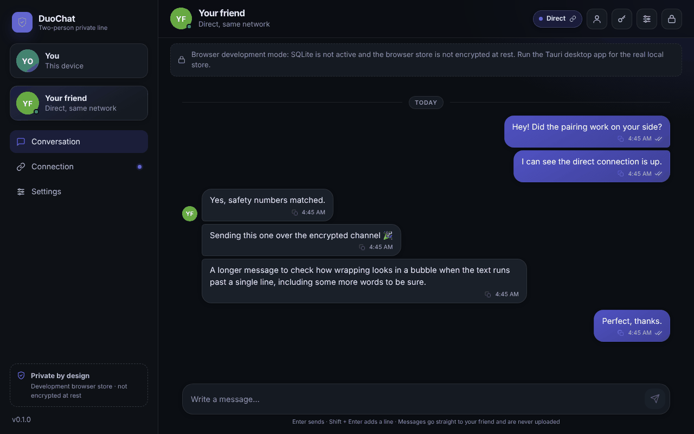

# PrivCord

A private, decentralized messenger supporting multi-contact, private group messaging, Bluetooth LE multi-hop mesh networking, and direct WebRTC peer-to-peer communication. End-to-end encrypted, no mandatory accounts, and no DuoChat/PrivCord-operated cloud backend.

<p align="center">
  
</p>

---

## Original Creator & Maintainer
- **Project**: PrivCord
- **Original Creator and Maintainer**: anandkrishna1900
- **Email**: [blackydog0007@gmail.com](mailto:blackydog0007@gmail.com)
- **GitHub**: https://github.com/anandkrishna1900
- **Repository**: https://github.com/anandkrishna1900/PrivCord

PrivCord is an independent project created and maintained by anandkrishna1900.

---

## What it is, and what it is not

PrivCord has **no required centralized server and no account system**. It is **not serverless**. Reaching peers across the internet needs signaling infrastructure, and the app is explicit about which roles are used and why. These roles are configured in *Settings > Network*:

| Role | What it does | Sees your messages? | Needed? |
|---|---|---|---|
| **Signaling** (Nostr relays or your own relay) | Delivers the encrypted offer/answer so paired friends find each other and reconnect automatically | No (sealed, signed blobs) | Only for automatic reconnect; connection codes work without it |
| **STUN** | Tells your device its public address for NAT traversal | No, no data passes through it | No; without it only same-network or BLE paths work |
| **TURN** | Relays the already-encrypted stream when no direct path exists (strict NAT/firewall) | Sees only DTLS ciphertext | No; add one if direct connections fail |
| **Store-and-forward relay** | Holds sealed messages while your peer is offline | No (sealed) | No. **Off by default** |
| **Bluetooth LE Direct & Mesh** | Local radio links with no internet at all | No | No |

The defaults use public third-party STUN servers (Google, Cloudflare) and public Nostr relays. They see connection metadata (your IP address, when you connect), never message content. Replace them with your own in *Settings > Network*, or run your own relay and TURN server ([docs/DEPLOYMENT.md](docs/DEPLOYMENT.md)).

The app always shows what it is really doing: the connection path (*Direct, same network*, *Direct, peer to peer*, *Relayed through TURN*, *Bluetooth LE*, *Mesh Route*) is read from live connection stats, never inferred from settings.

---

## Features

- **Cryptographic Identity from BIP-39**: 12-word recovery phrase generates identity keys (P-256 / secp256k1). The same phrase restores identity on any device.
- **Multi-Contact Architecture**: Scalable contact management, independent peer sessions, message queues, and Room database migrations.
- **Private Group Messaging**: Epoch-based group key rotation (MLS-style forward secrecy and post-compromise isolation). Removed members cannot decrypt future messages; new members cannot decrypt past history.
- **Bluetooth LE Multi-Hop Mesh**: Multi-hop store-carry-forward routing, packet deduplication, TTL decrement, loop prevention, and battery-aware relaying of encrypted ciphertext.
- **Tri-Mode Transport Selector**:
  - `AUTOMATIC`: Opportunistic best route (BLE Direct → BLE Mesh → WebRTC Direct → Relay Store-and-Forward → Local Queue).
  - `BLUETOOTH ONLY`: Air-gapped radio communication only.
  - `INTERNET ONLY`: WebRTC and configured relays only.
- **Chunked Encrypted File Sharing**: File transfer encrypted with per-transfer ephemeral AES-256-GCM keys and verified with SHA-256 checksums over WebRTC and Bluetooth.
- **Android Background Reception**: Persistent foreground service with `connectedDevice` type and battery optimization guidance.
- **Direct WebRTC P2P DataChannels**: Automatic reconnect, dead-link detection, and STUN/TURN fallback.
- **Local Encrypted Persistence**: Encrypted SQLCipher / Room DB on Android (Keystore-backed) and desktop SQLite AES-GCM encryption.
- **Emergency Deletion**: Kill switch clears local keys, databases, group epoch secrets, and cached media.

---

## Repository layout

| Path | What |
|---|---|
| `packages/protocol` | Shared TypeScript protocol: identity, sealed blobs, contact cards, secure channel, group crypto, mesh routing, chunked file transfer. Platform-independent and unit-tested. |
| `apps/desktop` | Windows desktop app: React + Vite UI in a Tauri 2 shell (Rust: secure storage, SQLite, Bluetooth). |
| `apps/android` | Native Android app (Kotlin, Jetpack Compose, Room v4, ForegroundService, BLE Mesh). |
| `relay` | Optional self-hosted signaling / store-and-forward relay (Node.js, minimal dependencies). |
| `docs` | Architecture and operations documentation. |

---

## Quick start (development)

Requires Node.js 20 or newer.

```bash
npm install
npm run typecheck
npm test                      # protocol + desktop unit tests
npm run dev:desktop           # UI in the browser at http://127.0.0.1:1420
```

Run your own relay:

```bash
cd relay && npm install && node index.js    # see relay/README.md for Docker and TLS
```

Build Android Debug APK:

```bash
cd apps/android
./gradlew.bat assembleDebug --no-daemon
```

---

## Documentation

- [Architecture Overview](docs/ARCHITECTURE.md)
- [Build and Installation Guide](docs/BUILD_AND_INSTALL.md)
- [Group Messaging Specification](docs/GROUP_MESSAGING.md)
- [Encrypted File Sharing Specification](docs/FILE_SHARING.md)
- [Verification and Test Report](docs/TEST_REPORT.md)
- [Connectivity Architecture](docs/CONNECTIVITY.md)
- [Identity and Recovery](docs/IDENTITY_AND_RECOVERY.md)
- [Bluetooth Transport](docs/BLE_TRANSPORT.md)
- [Emergency Deletion](docs/EMERGENCY_DELETION.md)
- [Credits & Attribution](CREDITS.md)
- [Commercial Licensing](COMMERCIAL_LICENSING.md)
- [Security Policy](SECURITY.md)

---

## License and Commercial Rights

PrivCord is distributed under the **PrivCord Community & Non-Commercial License (PC-NC)**.
See [LICENSE](LICENSE), [NOTICE](NOTICE), [CREDITS.md](CREDITS.md), and [COMMERCIAL_LICENSING.md](COMMERCIAL_LICENSING.md).

- **Non-Commercial Use**: Personal, educational, and research use is permitted subject to the conditions of the license.
- **Commercial Use**: Commercial use, including selling, paid hosted services, monetized features, or incorporating into commercial products, requires prior written authorization.
- **Licensing Contact**: [blackydog0007@gmail.com](mailto:blackydog0007@gmail.com)

**Created by [anandkrishna1900](https://github.com/anandkrishna1900).** If you use, modify, or redistribute this code or derivative works, you must retain the attribution notices and credit "PrivCord by anandkrishna1900".
