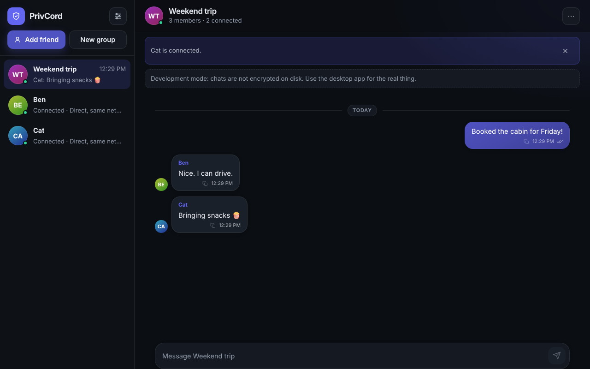
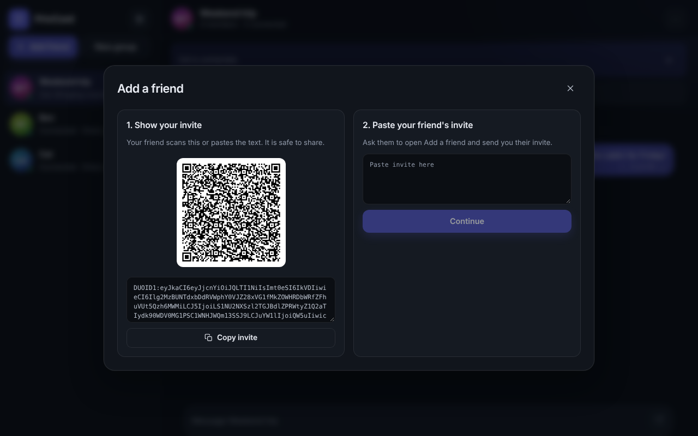
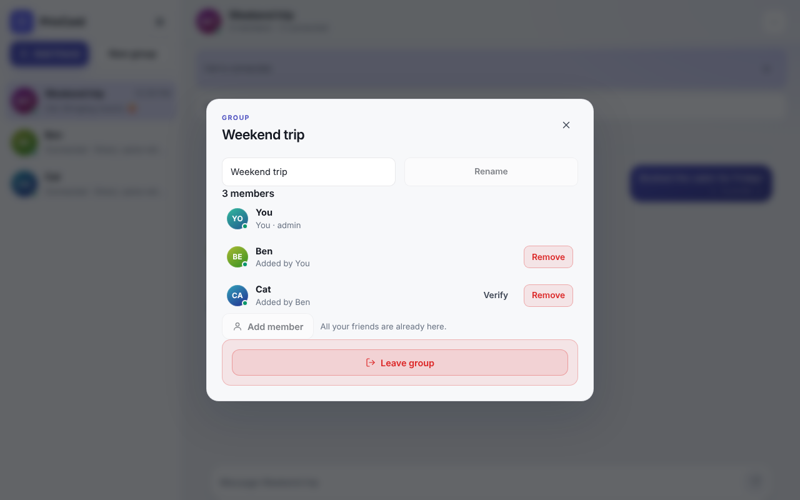

# PrivCord

**Private messaging with no accounts and no server that can read your chats.** Add friends with a QR code,
chat one-to-one or in groups, and PrivCord connects your devices directly, over the internet or over
Bluetooth.

<p align="center">
  
</p>

## What you can do

- **Add a friend in seconds.** Show a QR code or six words; your friend scans the code or types the words, and you tap *Add* when they answer. No long strings to copy.
- **Chat one-to-one** with end-to-end encryption. Messages go straight from device to device.
- **Reply** to any message. The quote shows for everyone, in chats and groups.
- **Send files up to 8 MB.** Photos and videos show a preview you can open; every file can be saved.
  They go straight to the other device, free, with no upload to anyone's server.
- **Lock the app.** Android asks for your fingerprint, face or screen lock; Windows asks for Windows Hello
  (a passkey). Turn it on or off in Settings > Security.
- **Make groups of up to 10.** Create a group, add friends, and anyone in the group can add more people.
  If you add Ben and Ben adds Cat, you and Cat connect automatically. No codes to swap.
- **Stay private in groups.** Turn on *Stay group-only* (Settings > Security) and people you only meet
  through a group can talk to you in the group but cannot message you directly. If either of you has it
  on, you can still pair by swapping invites.
- **Keep working when things go wrong.** Messages you send while someone is offline wait and are sent
  when you reconnect. Connections recover on their own.
- **Use Bluetooth with no internet** (needs a phone on one side; see the status table below).
- **Own your identity.** A 12-word recovery phrase is your account. Write it down: the same words
  restore your identity on a new device.
- **Wipe everything** from Settings > Security if you ever need to.

<p align="center">
  
  
</p>

## How it connects (and what it needs)

PrivCord has **no account system and no server that reads messages**. It is **not serverless**: to find a
friend across the internet it uses a few optional services. They do different jobs, and you can run your own.

| Service | Job | Sees your messages? | Needed? |
|---|---|---|---|
| **Signaling** (public Nostr relays, or your own) | Helps two devices find each other | No (sealed, signed blobs) | For automatic reconnect |
| **STUN** | Tells a device its public address | No | Without it, only same-network links |
| **TURN** | Relays the encrypted stream when a direct link is impossible | No (sees only encrypted data) | Only on strict networks |
| **Store-and-forward relay** | Holds sealed messages for friends who are offline | No | Off by default |
| **Bluetooth LE** | Local link, no internet at all | No | Optional |

The defaults use public third-party STUN and Nostr servers. They can see connection metadata (your IP
address and when you connect), never message content. Change them under *Settings > Advanced*, or host
your own: [docs/DEPLOYMENT.md](docs/DEPLOYMENT.md). The app shows the real connection type
(*direct*, *relayed*, *Bluetooth*), measured from the live connection.

## Get it

The desktop app (Windows) and the Android app are built by CI. Open the latest **CI** run on GitHub
and download the artifacts (`duochat-windows-unsigned` installer, `duochat-android-debug` APK). The
Windows installer is unsigned, so SmartScreen will warn you. Building from source:
[docs/DEPLOYMENT.md](docs/DEPLOYMENT.md).

## For developers

Requires Node.js 20+.

```bash
npm install
npm run typecheck
npm test                       # protocol + desktop unit tests
npm run dev:desktop            # UI in the browser at http://127.0.0.1:1420
npm run e2e --workspace @duochat/desktop   # real browsers, relay, Nostr, TURN (needs Playwright)
```

The browser build uses a development store that is **not encrypted at rest** and has no Bluetooth; use
the Tauri build (`npm run tauri:dev`, needs Rust) for the real thing. Run your own relay:
`cd relay && npm install && node index.js` ([relay/README.md](relay/README.md)).

| Path | What |
|---|---|
| `packages/protocol` | Shared TypeScript protocol: identity, sealed blobs, contacts, group logs, secure channel. Platform-independent and unit-tested. |
| `apps/desktop` | Desktop app: React + Vite in a Tauri 2 shell (Rust: secure storage, SQLite, Bluetooth) and the Playwright e2e suite. |
| `apps/android` | Android app: Kotlin and Jetpack Compose, with a Kotlin port of the protocol core checked against TypeScript vectors. |
| `relay` | Optional self-hosted signaling / store-and-forward relay (Node.js). |
| `docs` | Architecture and operations documentation. |

## Documentation

[Architecture](docs/ARCHITECTURE.md) · [Groups and introductions](docs/GROUPS.md) ·
[Connectivity](docs/CONNECTIVITY.md) · [Identity and recovery](docs/IDENTITY_AND_RECOVERY.md) ·
[Bluetooth](docs/BLE_TRANSPORT.md) · [Deployment](docs/DEPLOYMENT.md) ·
[Emergency deletion](docs/EMERGENCY_DELETION.md) · [Known limitations](docs/KNOWN_LIMITATIONS.md) ·
[Android status](docs/ANDROID_STATUS.md) · [Security policy](SECURITY.md)

## Status: what is tested, and what is not

| Area | Tested | Not tested |
|---|---|---|
| One-to-one messaging over WebRTC | Used on real hardware by the maintainer; automated e2e suite in real browsers | Two devices on different internet connections is not part of the automated tests |
| Groups and introductions | Protocol: 120+ unit tests, a 25-member simulation (identical rosters, full mesh), offline and forged-event cases. Desktop: real browsers, three-person introduction and a six-person group. Android: Kotlin port checked against TypeScript vectors and the same simulations | **Android groups on a real phone**, groups larger than 6 on real connections |
| Bluetooth | Link encryption and framing in code and on a simulated radio | **Any real Bluetooth radio**. Windows can only search, so a phone must be the other side |
| Android app | Compiles, unit tests, debug APK builds | The new engine and screens on a device or emulator; release build |
| Windows installer | Built by CI | Run on a clean machine; signing |
| App lock | Desktop: passkey create/verify/refuse flow against a virtual authenticator in a real browser. Android: the lock rules (unit tests) | **Real Windows Hello and real Android biometric prompts** |
| Relay | Automated tests | Docker image, production TLS |

Not available: push notifications, files over Bluetooth, and a multi-hop Bluetooth mesh
([docs/KNOWN_LIMITATIONS.md](docs/KNOWN_LIMITATIONS.md)).

## License and credit

PrivCord is distributed under the **PrivCord Community & Non-Commercial License (PC-NC)**. Personal,
educational and research use is permitted; commercial use needs written permission. See
[LICENSE](LICENSE), [NOTICE](NOTICE), [CREDITS.md](CREDITS.md) and
[COMMERCIAL_LICENSING.md](COMMERCIAL_LICENSING.md).

**Created by [anandkrishna1900](https://github.com/anandkrishna1900)**
([X / Twitter](https://x.com/AnandKrishnaK1)). If you use, modify or redistribute this code, keep the
attribution notices and credit "PrivCord by anandkrishna1900".
